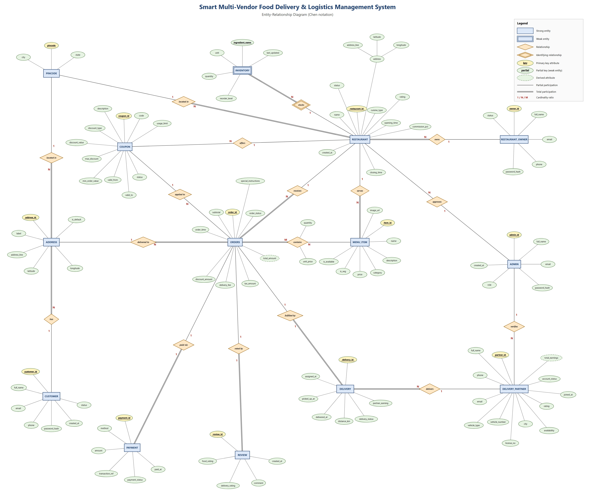

# Smart Multi-Vendor Food Delivery & Logistics Management System
**DBMS Mini Project** · Primary DB: **MySQL 8.0** · Secondary DB: **MongoDB 8** · Web app: **Next.js 16**

| Document | File |
|---|---|
| ER diagram | [er_diagram/er_diagram.png](er_diagram/er_diagram.png) |
| Mapping ER to relational (7-step algorithm) | [docs/01_er_to_relational_mapping.md](docs/01_er_to_relational_mapping.md) |
| Functional requirements | [docs/02_functional_requirements.md](docs/02_functional_requirements.md) |
| Functional dependencies and normalisation (BCNF) | [docs/03_functional_dependencies.md](docs/03_functional_dependencies.md) |
| MySQL DDL / data / queries | [sql/](sql/) |
| MongoDB collections | [mongodb/mongo_setup.js](mongodb/mongo_setup.js) |
| Web app | [web/](web/), started with `RUN_PROJECT.bat` (see [README.md](README.md)) |
| Full project report (Word) | [docs/Food_Delivery_DBMS_Project_Report.docx](docs/Food_Delivery_DBMS_Project_Report.docx) |
| Test results | [web/tests/test-results.md](web/tests/test-results.md) |

---

## 0. Review of the Earlier Work (what was wrong and how it was fixed)

| # | Problem in the earlier work | Fix in this version |
|---|---|---|
| 1 | **The DDL does not run.** In `CREATE TABLE 'Order'` the column is misspelled `restauant_id`, so the foreign key fails. | Tested DDL. All 15 tables create without errors on MySQL 8.0. |
| 2 | `Customer.address_id` and `Order.delivery_address_id` point to an **Address table that does not exist** | Added an `ADDRESS` entity. A customer has many saved addresses, and every order is *delivered to* one of them. |
| 3 | ORDER–MENU_ITEM *contains* is drawn **1:N**, but it is **M:N**. ORDER_ITEM was also drawn separately, so the same fact appeared twice. | One M:N relationship, *contains* (quantity, unit_price), which becomes the `Order_Item` table |
| 4 | ORDER–ORDER_ITEM *has* is marked **1:1** | Covered by the M:N fix |
| 5 | *paid by* and *assigned to* are drawn N:1 or 1:N, but the DDL makes them UNIQUE (1:1). **The diagram and the DDL contradict each other.** | Both are 1:1 in the diagram and in the DDL |
| 6 | **COUPON and INVENTORY** have no relationships | Added *applied to*, *offers* and *stocks* |
| 7 | REVIEW stores customer_id and restaurant_id, which follow from order_id: a **transitive dependency** | Review keeps only order_id |
| 8 | `Inventory(restaurant_id, item_id)`: `item_id → restaurant_id` makes restaurant_id **redundant** | Ingredient stock as a **weak entity** keyed by (restaurant_id, ingredient_name) |
| 9 | **No Admin entity and no commission**, though the problem needs both | Added ADMIN (*approves*, *verifies*) and `commission_pct` |
| 10 | The poster's "ER diagram" is a **table diagram** (it shows FKs). The second Chen diagram is a **different design**. | One Chen ER diagram that matches the schema and the DDL |
| 11 | Partner location stored as text in MySQL; earnings stored | Live GPS in **MongoDB** with a geo index; earnings are derived |
| 12 | `payment_status` stored twice; `ORDER` is a reserved word; no bill breakdown | Payment status only in Payment; the table is `Orders`; full bill columns |
| 13 | MongoDB had `chat_messages` (not asked for) and no activity logs | `order_tracking_events`, `partner_locations`, `notifications`, `activity_logs` |
| 14 | No insert scripts | At least 10 rows in every table, tested |

**Further fixes from the functional-dependency analysis** (see `docs/03_functional_dependencies.md`):

| FD found | Problem | Fix |
|---|---|---|
| `pincode → city` in Address and Restaurant | transitive dependency (3NF violation) | new **Pincode(pincode, city, state)** table |
| `address_id → customer_id` in Orders | transitive dependency, and an order could point to another customer's address | `customer_id` removed from Orders; the customer is found through the address |
| `{subtotal, discount, fee, tax} → total_amount` | a derived value that could go out of sync | `total_amount` is a **generated column** |

**Result:** all 15 tables are in **BCNF**.

---

## 1. Problem Statement

The **Smart Multi-Vendor Food Delivery & Logistics Management System** manages the complete food ordering and delivery process between customers, restaurants, delivery partners and administrators.

| User | What they do |
|---|---|
| **Customer** | Browse restaurants and menus, place orders, pay, track the delivery, rate the order |
| **Restaurant owner** | Manage outlets, menus, inventory, incoming orders and sales |
| **Delivery partner** | Go online, accept deliveries, update delivery status, see earnings |
| **Admin** | Approve restaurants, verify partners, set commissions, assign deliveries, monitor the platform |

**Key queries**
1. Find available restaurants and menu items matching the customer's requirements.
2. Track an order from placement to delivery.
3. Calculate restaurant revenue and popular menu items.
4. Find available delivery partners and assign deliveries efficiently.

Relational data (MySQL) handles transactions. NoSQL data (MongoDB) handles real-time tracking, notifications and activity logs.

The full list of requirements, grouped by module, is in **`docs/02_functional_requirements.md`**.

---

## 2. ER Diagram

**14 entities and 17 relationships**, in Chen notation:
- **Weak entity:** INVENTORY, through the identifying relationship *stocks*, with partial key `ingredient_name`
- **M:N with attributes:** ORDERS *contains* MENU_ITEM (`quantity`, `unit_price`)
- **1:1:** ORDERS–PAYMENT, ORDERS–DELIVERY, ORDERS–REVIEW
- **Composite attribute:** the restaurant `address` (address_line, latitude, longitude)
- **Derived attributes:** `total_earnings` (Delivery_Partner) and `total_amount` (Orders)
- **Total and partial participation** are marked with double and single lines

| Relationship | Entities | Ratio | Total participation |
|---|---|---|---|
| has | Customer – Address | 1 : N | Address |
| located in | Pincode – Address | 1 : N | Address |
| located in | Pincode – Restaurant | 1 : N | Restaurant |
| delivered to | Address – Orders | 1 : N | Orders |
| receives | Restaurant – Orders | 1 : N | Orders |
| contains | Orders – Menu_Item | M : N | Orders |
| serves | Restaurant – Menu_Item | 1 : N | Menu_Item |
| stocks (identifying) | Restaurant – Inventory | 1 : N | Inventory |
| owns | Restaurant_Owner – Restaurant | 1 : N | Restaurant |
| offers | Restaurant – Coupon | 1 : N | – |
| applied to | Coupon – Orders | 1 : N | – |
| paid via | Orders – Payment | 1 : 1 | Payment |
| fulfilled by | Orders – Delivery | 1 : 1 | Delivery |
| delivers | Delivery_Partner – Delivery | 1 : N | Delivery |
| rated by | Orders – Review | 1 : 1 | Review |
| approves | Admin – Restaurant | 1 : N | – |
| verifies | Admin – Delivery_Partner | 1 : N | – |

---

## 3. Mapping ER to Relational, and the Relational Schema

The full step-by-step mapping is in **`docs/01_er_to_relational_mapping.md`**. In short:

| ER construct | Becomes |
|---|---|
| 13 strong entities | 13 tables |
| Weak entity INVENTORY | table with composite PK (restaurant_id, ingredient_name), FK `ON DELETE CASCADE` |
| 3 × 1:1 | `UNIQUE NOT NULL` FK on the total side (Payment, Delivery, Review) |
| 12 × 1:N | FK on the N side |
| M:N *contains* | the `Order_Item` table |
| Composite address | its columns |
| Derived attributes | generated column (total_amount) / computed in queries (total_earnings) |

**bold** = PK, *italic* = FK

1. **Admin**(**admin_id**, full_name, email UNIQUE, password_hash, role, created_at)
2. **Pincode**(**pincode**, city, state)
3. **Customer**(**customer_id**, full_name, email UNIQUE, phone UNIQUE, password_hash, created_at, status)
4. **Address**(**address_id**, *customer_id*, label, address_line, *pincode*, latitude, longitude, is_default)
5. **Restaurant_Owner**(**owner_id**, full_name, email UNIQUE, phone UNIQUE, password_hash, status)
6. **Restaurant**(**restaurant_id**, *owner_id*, name, cuisine_type, address_line, *pincode*, latitude, longitude, opening_time, closing_time, commission_pct, rating, status, *approved_by*, created_at)
7. **Menu_Item**(**item_id**, *restaurant_id*, name, description, category, price, is_veg, is_available, image_url), UNIQUE(restaurant_id, name)
8. **Inventory**(***restaurant_id*, ingredient_name**, unit, quantity, reorder_level, last_updated)
9. **Coupon**(**coupon_id**, code UNIQUE, description, discount_type, discount_value, max_discount, min_order_value, valid_from, valid_to, usage_limit, *restaurant_id* NULL, status)
10. **Orders**(**order_id**, *address_id*, *restaurant_id*, *coupon_id* NULL, order_time, subtotal, discount_amount, delivery_fee, tax_amount, total_amount *GENERATED*, order_status, special_instructions)
11. **Order_Item**(***order_id*, *item_id***, quantity, unit_price)
12. **Payment**(**payment_id**, *order_id* UNIQUE, method, amount, transaction_ref UNIQUE, payment_status, paid_at)
13. **Delivery_Partner**(**partner_id**, full_name, phone UNIQUE, email UNIQUE, vehicle_type, vehicle_number UNIQUE, license_no UNIQUE, city, availability, rating, joined_at, account_status, *verified_by*)
14. **Delivery**(**delivery_id**, *order_id* UNIQUE, *partner_id*, assigned_at, picked_up_at, delivered_at, distance_km, delivery_status, partner_earning)
15. **Review**(**review_id**, *order_id* UNIQUE, food_rating, delivery_rating, comment, created_at)

**Constraints:**
- PK, composite PK, FK (CASCADE or RESTRICT), UNIQUE, NOT NULL, DEFAULT, ENUM, a GENERATED column.
- CHECK constraints:
  - pincode format
  - price and quantity > 0
  - ratings 1–5
  - commission 0–40%
  - coupon dates and percent ≤ 100
  - discount ≤ subtotal
  - delivery timestamps in order
  - closing time after opening time
  - a bike or scooter needs a vehicle number and licence

---

## 4. Functional Dependencies and Normalisation

The full analysis is in **`docs/03_functional_dependencies.md`**. It covers the FDs, candidate keys, closures, and checks for 1NF, 2NF, 3NF and BCNF.

| Table | Key FDs | Candidate keys | NF |
|---|---|---|---|
| Pincode | pincode → city, state | {pincode} | BCNF |
| Customer | customer_id → all; email → customer_id; phone → customer_id | {customer_id}, {email}, {phone} | BCNF |
| Address | address_id → customer_id, label, address_line, pincode, lat, lng, is_default | {address_id} | BCNF |
| Menu_Item | item_id → all; (restaurant_id, name) → item_id | {item_id}, {restaurant_id, name} | BCNF |
| Inventory | (restaurant_id, ingredient_name) → unit, quantity, reorder_level, last_updated | {restaurant_id, ingredient_name} | BCNF |
| Orders | order_id → address_id, restaurant_id, coupon_id, bill columns, status | {order_id} | BCNF |
| Order_Item | (order_id, item_id) → quantity, unit_price | {order_id, item_id} | BCNF |
| Payment / Delivery / Review | x_id → all; order_id → x_id | {x_id}, {order_id} | BCNF |
| all others | id → all; email/phone/code → id | id and the unique columns | BCNF |

**Not FDs, on purpose:**
- `item_id ↛ unit_price`: the price at order time.
- `subtotal ↛ delivery_fee`: fee policy changes.
- `distance_km ↛ partner_earning`: pay rules change.
- `city ↛ state`: the same city name exists in more than one state.

---

## 5. Database Choice and Justification

### MySQL (primary)
Orders, payments and deliveries are **transactions** that must never be half-done.
- **ACID.** Placing an order writes Orders, Order_Item and Payment in one transaction. Assigning a partner inserts Delivery and marks the partner BUSY with row locks (`SELECT … FOR UPDATE`), so two admins can't double-book a partner.
- **Referential integrity** through foreign keys; **JOINs and aggregates** for revenue, history and popular items.
- **CHECK, UNIQUE, ENUM and a GENERATED column** keep money, ratings and statuses correct.

### MongoDB (secondary)
| Collection | What it stores | Why MongoDB |
|---|---|---|
| `partner_locations` | latest GPS point of each partner | frequent upserts; 2dsphere index and `$geoNear` find the nearest partner (key query 4) |
| `order_tracking_events` | every status change and GPS point of an order | append-only event stream, read in time order (key query 2) |
| `notifications` | push, SMS and e-mail to every user type | write-heavy, flexible shape |
| `activity_logs` | audit trail | each action has different details |

MySQL is the source of truth. MongoDB is written after the MySQL commit, so if MongoDB is down, orders still work.

---

## 6. MySQL Database, Tables and Data

- `sql/01_create_schema.sql`: database `food_delivery`, **15 tables**, 5 indexes
- `sql/02_insert_data.sql`: **294 rows**, at least 10 per table; a snapshot from 25 Oct 2026
- `sql/03_key_queries.sql`: all key queries, plus consistency checks that return no rows

| Table | Rows | Table | Rows | Table | Rows |
|---|---|---|---|---|---|
| Admin | 10 | Restaurant | 12 | Order_Item | 50 |
| Pincode | 14 | Menu_Item | 40 | Payment | 25 |
| Customer | 12 | Inventory | 22 | Delivery_Partner | 12 |
| Address | 15 | Coupon | 10 | Delivery | 21 |
| Restaurant_Owner | 10 | Orders | 25 | Review | 16 |

**Sample result (Q3, revenue 1–25 Oct):**
- Punjab Da Dhaba: ₹2,440 food sales, ₹439.20 commission, ₹2,000.80 payout.
- Spice Route Biryani: ₹2,380 food sales, ₹1,791.60 payout.
- Most popular item: Butter Naan, 14 sold.

---

## 7. Web Application (Next.js)

`web/` is a Next.js 16 app. React pages call API route handlers (`web/app/api`), which talk to MySQL and MongoDB. Users log in with one of four roles; passwords are bcrypt hashes, sessions are signed httpOnly cookies, and every API route checks the role. Database settings come only from environment variables (`web/.env.local`).

Advanced SQL used by the app:
- stored procedures `sp_place_order` and `sp_assign_partner` (transactions with row locks);
- 4 stored functions;
- 6 triggers (order status rules, refunds, delivery sync, review rules, rating refresh);
- 5 views;
- FULLTEXT search;
- ALTER/DROP statements in `sql/02_alter_schema.sql`.

DELETE is used for addresses, menu items and coupons. Foreign keys block a delete when order history depends on the row.

32 automated API tests: see `web/tests/test-results.md`.

## 8. How to Run

Right-click `RUN_PROJECT.bat` → **Run as administrator**, type the MySQL root password, then open http://localhost:3000. Demo logins (password `Demo@123`): aarav.sharma@gmail.com (customer), gopal@udupiupahar.in (owner), ravi.s@gmail.com (partner), lakshmi.iyer@foodhub.in (admin). Manual steps are in [README.md](README.md).

## 9. Features Done and Remaining Work

### Done
- [x] Problem statement, functional requirements, key queries
- [x] Chen ER diagram (14 entities, 17 relationships)
- [x] ER to relational mapping, documented step by step
- [x] Functional dependencies; all tables in BCNF
- [x] MySQL DDL (15 tables) and data (294 rows), tested
- [x] MongoDB collections with sample data and geo queries
- [x] Web UI for all four roles, connected to both databases

### Next phase
| # | Feature | DBMS concept |
|---|---|---|
| 1 | Move "place order" and "assign partner" into the database | **Stored procedures** with transactions |
| 2 | Refresh restaurant rating when a review is added | **AFTER INSERT trigger** |
| 3 | Reduce ingredient stock on order acceptance; disable items at zero | **Trigger** |
| 4 | Bill calculator in the database | **Stored function** |
| 5 | Sales and commission reports | **Views**, window functions |
| 6 | Separate database users for app roles | **GRANT / roles** |
| 7 | Login and sign-up with bcrypt, address management, owner menu editing | app features |
| 8 | Nested, correlated and set-operation queries for the final report | SQL |
